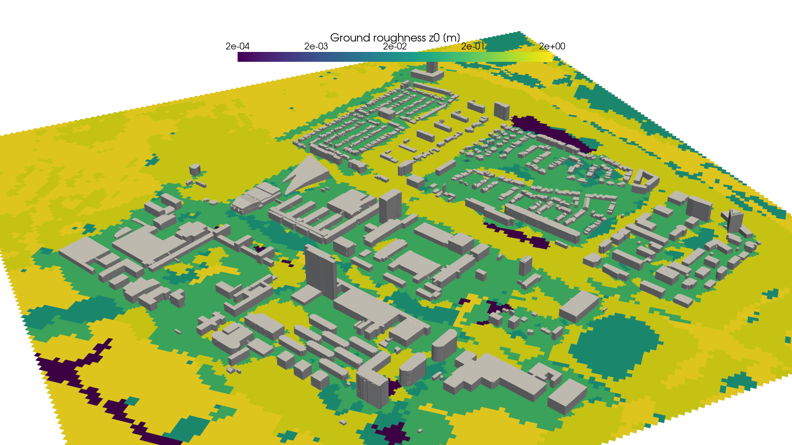
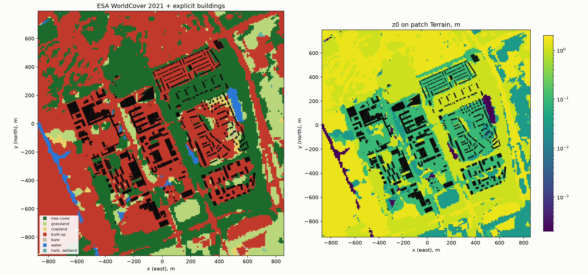
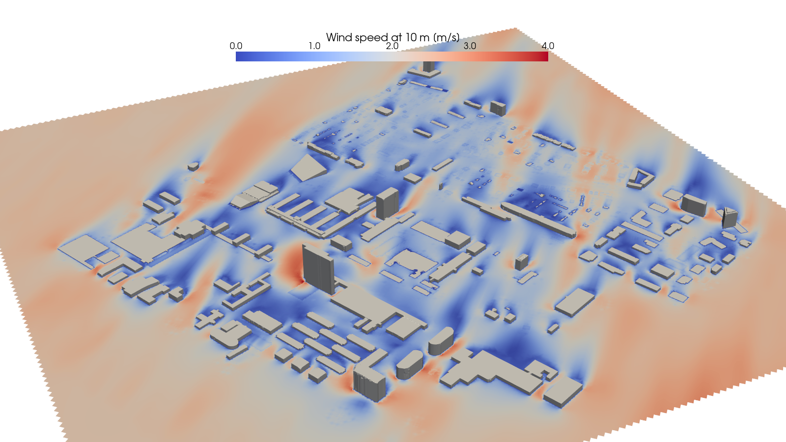

# z0-worldcover-openfoam



Ground roughness **z0** for OpenFOAM atmospheric boundary layer (ABL) cases, taken from the
**ESA WorldCover 2021** land-cover map (10 m). Each ground face gets the z0 of the land under it:
trees, grass, water and built-up areas each have their own value, and buildings that are already
in the mesh are not counted twice. The same run writes ground **albedo** and **sensible fraction**
per point, which the solar ray-casting tool
[solar-raycast-openfoam](https://github.com/Jupihawx/solar-raycast-openfoam) reads.

- OpenFOAM **v2412** (openfoam.com / ESI). The Foundation version (openfoam.org) has different boundary
  condition names and no `atmosphericModels` library in this form: the case files will not run there.
  The example was also run on v2606 (see [Example](#example-tu-delft-campus)).
- Python ≥ 3.10.
- Status: the tools run and are stable on meshes from 0.5 M to 34 M cells. The z0 values are table
  values per land-cover class, not a calibrated or validated roughness map (see [Limitations](#limitations)).

| File | What it does |
|---|---|
| `make_z0.py` | Downloads WorldCover tiles (once), samples them on a grid in mesh coordinates, writes z0, albedo, sensibleFraction and alignment figures |
| `tools/z0_faces.py` | Turns the z0 map into a **per-face list in polyMesh face order** for the wall functions |
| `tools/decompose_z0.py` | After `decomposePar`: writes each processor its own slice of the z0 list (works around a v2412 decomposePar issue) |
| `tools/check_wall_lists.py` | Puts the z0 list (and what the solver used) on the ground faces as a `.vtp` for ParaView |
| `example/` | TU Delft campus (OSM buildings, STL included) and a neutral `simpleFoam` case, 855 k cells; `clean_stl.py` for Blosm exports |
| `docs/pitfalls.md` | What went wrong on the way and how it was fixed |

---

## Conventions

| | |
|---|---|
| Mesh axes | x = East, y = North, z = up, metres, **ground at z = 0** |
| Projection | Transverse Mercator centred on (`lat0`, `lon0`), `+k=1`, WGS84. This is what Blender + Blosm exports (scene `lat`/`lon`) |
| Wind direction `dirFrom` | meteorological: the direction the wind blows **from**, degrees clockwise from North. `flowDir = (−sin dirFrom, −cos dirFrom, 0)` |
| `Zref` | 100 m (ERA5 100 m wind) |
| `z0In` | the **only** inlet roughness: one value per site, or per direction sector (see [Inlet roughness](#inlet-roughness-z0in)) |
| Patches | `Terrain` (ground, from blockMesh) and `Buildings` (snappyHexMesh) are the walls the tools work on. The example adds `inlet`, `outlet`, `sides`, `top` (box aligned with the wind) |

If your geometry was moved, rotated or scaled after export, the lat/lon no longer lines up: undo the
transform, or pass the lat/lon of the new origin.

## Install

```bash
python3 -m venv ~/venvs/z0           # or: uv venv --python 3.12 ~/venvs/z0
~/venvs/z0/bin/python -m pip install -r requirements.txt
```

`rasterio` and `pyproj` ship binary wheels with GDAL/PROJ included; no system GDAL is needed.
On Ubuntu/WSL with a system Python that blocks `pip` (PEP 668), use a venv as above.

## Inputs

- `<case>/geo/Buildings.stl`: the buildings that are in the mesh, in the same coordinates as the mesh.
- `<case>/logs/blockMesh.log` with the `boundingBox:` line (run blockMesh first), **or** `--radius <m>`.
- `lat0`, `lon0`: the projection origin. From Blender + Blosm: Python console, `C.scene["lat"], C.scene["lon"]`.
  From the example: `geo/site.json`.
- Internet on the first run. Tiles (3° × 3°, 35–100 MB each) are cached in `~/worldcover` (`--tile-dir`).

## Outputs

| Output | Use |
|---|---|
| `constant/boundaryData/Terrain/points` | Sample points, regular grid (`--dx`, default 20 m), z = 0 |
| `constant/boundaryData/Terrain/0/z0` | z0 per point |
| `constant/boundaryData/Terrain/0/albedo`, `0/sensibleFraction` | Ground materials for the solar tool (`--material-map`) |
| `constant/wallLists/Terrain.z0` | Per-face z0 list from `tools/z0_faces.py` |
| `geo/z0_map.png`, `geo/z0_map_zoom.png` | Land cover and z0 with the building roofs on top: **alignment check** |
| `geo/inlet_z0_sectors.csv` | Log-mean z0 of the land **upstream** of the domain per inflow direction (for `z0In`) |
| printed summary | Share of each land-cover class, inlet z0 per sector |

## Quickstart

```bash
source /usr/lib/openfoam/openfoam2412/etc/bashrc        # your OpenFOAM install
cd <case>                                               # blockMesh (and snappyHexMesh) already run
python3 <repo>/make_z0.py --lat0 <lat0> --lon0 <lon0>   # -> constant/boundaryData/Terrain, geo/*.png
python3 <repo>/tools/z0_faces.py . --patch Terrain      # -> constant/wallLists/Terrain.z0
```

Check `geo/z0_map_zoom.png` (the building roofs must sit on red built-up pixels; parks, canals and
lakes must line up):



Then set the wall functions:

```
// 0/nut
Terrain
{
    type            atmNutkWallFunction;
    z0              #include "$FOAM_CASE/constant/wallLists/Terrain.z0";
    boundNut        true;
    value           uniform 0;
}
// 0/epsilon
Terrain
{
    type            atmEpsilonWallFunction;
    z0              #include "$FOAM_CASE/constant/wallLists/Terrain.z0";     // the same list
    value           uniform $epsilonInlet;
}
```

`controlDict` needs `libs (atmosphericModels);`. In parallel:

```bash
decomposePar -force
python3 <repo>/tools/decompose_z0.py . Terrain      # REQUIRED in v2412, see below
mpirun -np 4 simpleFoam -parallel
```

### The per-face list and the decomposePar step

The list belongs to one mesh: **rerun `z0_faces.py` after every
remesh** (it reads `constant/polyMesh`, or the latest `<time>/polyMesh` if snappyHexMesh wrote one;
`--time` to choose).

In OpenFOAM v2412, `decomposePar` does **not** split the `z0` list of `atmNutkWallFunction` /
`atmEpsilonWallFunction`: every processor receives the start of the full list, so the ground gets
scrambled roughness (a woven pattern in `nut`, `alphat`, `epsilon`). Ordinary lists (e.g. `value`,
`refValue`) are split correctly. `tools/decompose_z0.py` writes each processor its own slice using
`processor*/constant/polyMesh/faceProcAddressing` (ascii and binary fields). `reconstructPar` has the
same problem in reverse: the reconstructed `nut` z0 is scrambled, while the flow fields are fine.
Not checked against the OpenFOAM source; re-test on newer versions (see `docs/pitfalls.md`).

## How z0 is assigned

| WorldCover class | z0 [m] (Wieringa 1992) | albedo | sensible fraction |
|---|---|---|---|
| 10 tree cover | 1.0 | 0.18 | 0.4 |
| 20 shrubland | 0.25 | 0.20 | 0.6 |
| 30 grassland | 0.03 | 0.23 | 0.5 |
| 40 cropland | 0.10 | 0.20 | 0.5 |
| 50 built-up | 1.5 | 0.15 | 0.9 |
| 60 bare | 0.005 | 0.20 | 0.7 |
| 70 snow/ice | 0.0002 | 0.60 | 0.3 |
| 80 water, and no data (open sea) | 0.0002 | 0.07 | 0.15 |
| 90 herbaceous wetland | 0.03 | 0.15 | 0.3 |
| 95 mangroves | 0.5 | 0.15 | 0.3 |
| 100 moss/lichen | 0.03 | 0.20 | 0.5 |

Albedo and sensible fraction (share of the absorbed shortwave that heats the air) are typical values
after Oke et al. (2017), *Urban Climates*.

**Explicit buildings are not counted twice.** Built-up pixels within `--explicit-dist` (50 m) of a
building in `Buildings.stl` get `--z0-explicit` (0.1 m), because the mesh already resolves those
buildings' drag. Their albedo and sensible fraction stay at the built-up values. Trees, grass and water between the buildings
keep their own z0: they are not in the mesh.

To change the table, edit `CLASSES` / `SURFACE` at the top of `make_z0.py` and rerun: no remeshing.

## Inlet roughness `z0In`

`z0In` in `0/include/ABLConditions` sets the inlet profile: U, k, epsilon and uStar all derive from it.
It is **one value per site** by default (0.7 m urban, 0.5 m suburban, 0.03 m open grass, 0.0002 m sea),
because the profile up to ~100 m reflects tens of kilometres of fetch, not the land just outside the
domain.

`geo/inlet_z0_sectors.csv` gives, for each inflow direction (`dir_from_deg`), the log-mean z0 of a
strip from the domain edge to `--fetch` (5 km) upstream. Use it per case where the fetch really changes
with direction, e.g. a coastal site with open sea on one side:

```
dirFrom   <d>;
z0In      <z0_logmean_m of the nearest sector>;
```

Local water in the strip (canals, reservoirs) pulls the log-mean down; judge it, don't copy it blindly.

## Options of `make_z0.py`

| Option | Default | Meaning |
|---|---|---|
| `--case` | `.` | Case directory |
| `--lat0`, `--lon0` | required | Projection origin |
| `--stl` | `geo/Buildings.stl` | Explicit buildings, relative to the case |
| `--patch` | `Terrain` | Ground patch name: `boundaryData/<patch>` |
| `--radius` | from `logs/blockMesh.log` + 5 % | Half-size of the sampled area, m |
| `--dx` | 20 | Sample spacing, m (WorldCover is 10 m: finer gains nothing) |
| `--explicit-dist` | 50 | Built-up pixels closer than this to a building count as explicit, m |
| `--z0-explicit` | 0.1 | z0 between explicit buildings, m |
| `--fetch` | 5000 | Upstream strip for the inlet z0, m |
| `--sectors` | 32 | Inflow sectors in the CSV |
| `--tile-dir` | `~/worldcover` | Tile cache |

## RAM and runtime

Example (TU Delft, 855 k cells, 127 k ground faces, 8 ranks): `make_z0.py` with `--dx 10` over a 2.4 km radius (~180 k points) plus `z0_faces.py` and `decompose_z0.py` took ~6 s together; the first run adds ~1 min for the tile download. Full example timings: [`example/README.md`](example/README.md).

`z0_faces.py` reads the full `points` and `faces` files into memory: plan RAM of a few times their size on disk.

## Example: TU Delft campus

`example/` is a real site (~1.3 km of TU Delft campus and housing from OpenStreetMap, 855 k cells) that
runs end to end in about 6.5 minutes on a desktop: see [`example/README.md`](example/README.md). The same case is
the example of the solar repository.



## Limitations

- WorldCover 2021 is classified from satellite data at 10 m: class edges can be off, and 2021 may predate
  recent construction.
- z0 per class is a table value; treat it as uncertain by about a factor of 2.
- `atmNutkWallFunction` uses `log((y + z0)/z0)`. With large z0 (≥ 1 m), keep the first cell reasonably
  tall there, or the wall function sits deep inside the roughness layer.
- No displacement height (`d = 0`).
- Wall results (shear stress, heat transfer) depend on the first-cell height: interpret them where the
  ground cells have one uniform height (see `docs/pitfalls.md`).

## Data and attribution

- **ESA WorldCover 2021 v200**: © ESA WorldCover project 2021 / Contains modified Copernicus Sentinel
  data (2021) processed by ESA WorldCover consortium. Licence CC BY 4.0. Zanaga et al. (2022),
  doi:[10.5281/zenodo.7254221](https://doi.org/10.5281/zenodo.7254221). Tiles are downloaded at run time,
  not stored in this repository.
- **OpenStreetMap** (example geometry): © OpenStreetMap contributors, Open Database Licence (ODbL 1.0),
  <https://www.openstreetmap.org/copyright>. `example/case/geo/Buildings.stl` is derived from it and
  stays under the ODbL; if you share or adapt it, keep this attribution.

## Licence and citation

Code: MIT, see [LICENSE](LICENSE). To cite, see [CITATION.cff](CITATION.cff).
